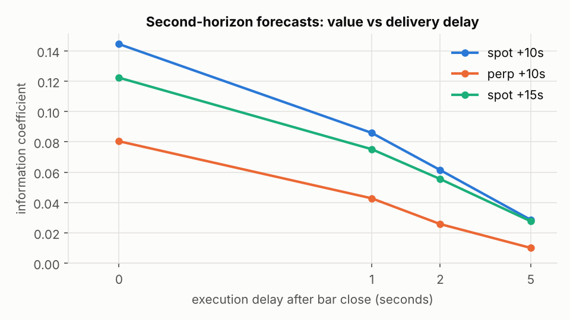
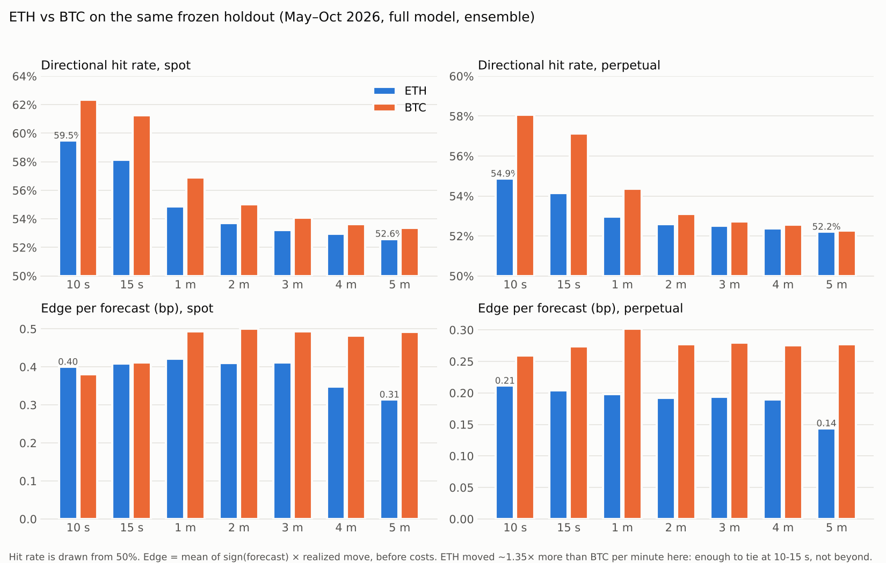

# eth-predict — 10-second to 5-minute Ethereum forecaster

Every minute, this forecasts how ETH will move over the **next 10 seconds, 15 seconds, and 1, 2,
3, 4 and 5 minutes**. It covers both Binance spot (ETH/USDT) and the USD-M perpetual. Each
forecast includes:
* a calibrated **P(up)**
* an expected move
* 80% and 95% bands
* a confidence percentile, with the historical hit rate at that confidence level

It is the sibling of [btc-predict](https://github.com/xin10ylop/btc-predict) and shares its
machinery. **The research was redone for ETH rather than copied**, and several Bitcoin
conclusions turned out not to hold for Ethereum. The models were built from 18 months of
one-second data (~790k minute bars) across Binance spot, Binance futures and Coinbase. The
headline numbers come from a **frozen 6-month holdout (May → Oct 2026)** that was not used for
any design decision.

> **Read this first.** At these horizons Ethereum is close to a random walk.
> * A real, durable edge looks like **53–55% hit rate on all 1-minute bars** and **~59% at 10
>   seconds**, rising to **58–72% on the most confident 10%** of calls.
> * The edge is mostly **seconds-scale lead-lag**: ETH spot catching up with the ETH perp and
>   with Coinbase. It loses ~45% of its value if you act 2 seconds late at 1 minute, and ~60% at
>   10 seconds.
> * It is far smaller than taker fees (4–10 bp round trip). Treat it as a *signal* — for market
>   making, execution timing or short-horizon prediction markets — not as a standalone money
>   printer.
> * **ETH turned out *less* predictable than BTC**, for a structural reason (it is the faster
>   market). That finding, and why, is the most useful thing in this repo; see below.

## Results: 6-month frozen holdout (May → Oct 2026, ~260k forecasts per target)

Walk-forward evaluation, with the models retrained every two months on all prior data. No design
decision looked at these months. Full model (Binance spot + futures + Coinbase); "hit @ +2s" is
the hit rate if the forecast is acted on 2 seconds after the bar close.

| target | hit rate | AUC | IC | top-10% conf. hit | top-1% conf. hit | hit @ +2s | months with IC > 0 |
|---|---|---|---|---|---|---|---|
| spot +10s | **59.5%** | 0.631 | 0.145 | 72.3% | 79.1% | 54.9% | 6/6 |
| spot +15s | **58.1%** | 0.614 | 0.122 | 70.0% | 76.6% | 54.5% | 6/6 |
| spot +1m | **54.9%** | 0.568 | 0.067 | 62.1% | 68.6% | 53.1% | 6/6 |
| spot +2m | 53.7% | 0.551 | 0.046 | 59.0% | 63.2% | 52.6% | 6/6 |
| spot +5m | 52.6% | 0.537 | 0.025 | 57.0% | 59.2% | 52.1% | 6/6 |
| perp +10s | 54.9% | 0.571 | 0.080 | 64.0% | 69.1% | 52.6% | 6/6 |
| perp +1m | 53.0% | 0.542 | 0.035 | 58.0% | 61.9% | 52.2% | 6/6 |
| perp +5m | 52.2% | 0.533 | 0.015 | 56.1% | 56.2% | 52.0% | 6/6 |

The **spot-only variant** (no futures data, for regions where Binance futures are blocked) reaches
57.5% at spot +10 s, 54.2% at +1 m and 52.5% at +5 m. Every horizon (3 and 4 minutes too) is in
[`reports/holdout/results_table.md`](reports/holdout/results_table.md).



### When is ETH predictable? (holdout, full model, spot +1 m)

| slice | IC | hit |
|---|---|---|
| low-vol tercile | 0.127 | 56.6% |
| high-vol tercile | 0.054 | 53.4% |
| weekend | 0.074 | 56.2% |
| weekday | 0.067 | 54.4% |
| US hours 13–21 UTC | 0.059 | 54.3% |
| Asia 00–08 UTC | 0.072 | 55.2% |

Same pattern as BTC, same mechanism: predictability is highest where arbitrage between venues
is slowest.

### What the edge is worth (spot +1 m, before costs)

| calls taken | gross edge per call | acting 2 s late | calls per day |
|---|---|---|---|
| all | 0.42 bp | 0.21 bp | 1440 |
| most confident 10% | 0.84 bp | 0.51 bp | 144 |
| most confident 1% | 1.13 bp | 0.79 bp | 14 |

Round-trip taker costs are 4–10 bp. Details for every horizon:
[`reports/holdout/edge_vs_costs.json`](reports/holdout/edge_vs_costs.json).

## Is ETH more predictable than BTC? What the data says, and why

This was the starting hypothesis: ETH should be more predictable, because BTC leads and ETH
follows. Each possible reason was tested on both assets with identical code (pre-holdout data;
details in [FINDINGS §0](docs/FINDINGS.md)).

| reason ETH could be more predictable | verdict |
|---|---|
| BTC leads ETH | **No, ETH leads BTC**: at 1 s (0.15 vs 0.09 cross-correlation) and at 1 min (0.028 vs 0.004) |
| ETH follows BTC-specific shocks | **Barely.** After a sharp BTC-only move, ETH follows 54% at +10 s and 50% by +60 s. BTC follows ETH 55–58%. |
| ETH prices are less efficient | **No.** BTC deviates more from a random walk at every scale up to 30 s, in 12 of 12 months |
| ETH's leverage makes moves continue | **No.** Continuation after a 3σ minute is weaker for ETH spot and equal on the perps |
| ETH moves more, so signals are worth more | **Yes, but shrinking.** ETH moved ~2× BTC per minute in mid-2025, only ~1.35× in 2026 |

**Why.** Short-horizon predictability comes from *lagging* prices catching up with *leading*
ones. ETH is the faster, more active market:
* 33% more perp trades per second than BTC;
* fewer stale seconds;
* it leads BTC.

So there is less "ahead of ETH" to forecast from. BTC is the one that catches up with ETH and
Coinbase. Recent high-frequency literature agrees: no consistent BTC lead, and BTC often lagging.

**Where ETH's predictability does live:**
1. ETH spot catching up with the ETH perp (the basis);
2. the Coinbase ETH premium;
3. bp economics: ETH's lower IC buys more bp per unit of IC, because it moves more. On the DEV
   months that made ETH's edge equal to BTC's; in the 2026 holdout, with the ETH/BTC volatility
   ratio down to 1.35×, it did not (see below).

### ETH vs BTC on the same holdout



| target | ETH hit | BTC hit | ETH edge (bp) | BTC edge (bp) |
|---|---|---|---|---|
| spot +10s | 59.5% | 62.4% | 0.40 | 0.38 |
| spot +1m | 54.9% | 56.9% | 0.42 | 0.49 |
| spot +5m | 52.6% | 53.4% | 0.31 | 0.49 |
| perp +1m | 53.0% | 54.4% | 0.20 | 0.30 |

BTC wins on every hit rate. ETH's larger moves pull the bp edge level at 10–15 seconds, but not
beyond. The ETH/BTC volatility ratio has fallen from ~2× in mid-2025 to ~1.35× in 2026, and it
was that ratio that had made ETH's edge competitive on the earlier DEV months (0.45 vs 0.43 bp
at spot +1 m).

## Built for regime change

1. **Scale-free inputs.** Every return is measured in units of current volatility and every flow
   in units of typical volume, so a calm month and a wild month look alike to the model.
2. **The model sees the regime.** Volatility-state features let its forecasts shrink on their own
   in storms.
3. **Core + satellite + online learning.** The satellite adds cross-venue signals: Coinbase, the
   BTC perp and the swarm. The online layer (h ≤ 1 m) moves weight back to the robust core within
   days if one of those relationships breaks. That is what saved btc-predict when BTC/FDUSD
   collapsed in Feb 2026.
4. **Regime-conditional uncertainty.** Bands are conditioned on the volatility regime, the
   New-York hour and the variance ratio.
5. **Few venues on purpose.** The ETH/USDC book and a 17-coin swarm were tested and dropped. They
   added nothing for ETH, and every extra venue is one more relationship that can break.
6. **Rejected:** slow "regime" features at 2–5 minutes. They looked like an ETH-specific gain on
   the DEV months (+0.0065 IC) and vanished on the untouched confirmation months, which is the
   signature of memorizing a period ([FINDINGS §4](docs/FINDINGS.md)).
7. **Refresh.** `make refresh` retrains on all data each month. A full re-validation
   (`train_final.py`) every few months re-checks the calibration.

## How it works

```
 Binance ETH spot 1s ─┐                              ┌─ CORE model (LightGBM)
 Binance ETH perp ────┤   second-level features      │  ETH spot/perp microstructure:
   trades + premium   │   at each bar close:         │  perp-spot basis deviation, flow
 BTC spot 1s ─────────┼─► returns, order flow, ─────►│  imbalance, realized vol, reversal,
                      │   basis, swarm, Coinbase     │  BTC spot
 BTC perp trades ─────┤   premium ...                └─ SATELLITE model (LightGBM)
 SOL/XRP/DOGE/BNB 1s ─┤   (all scale-free: in units     core + Coinbase ETH premium,
 Coinbase ETH-USD ────┘    of current vol / volume)      BTC perp, 5-coin swarm
                                    │
                                    ▼
     h <= 1 m: online discounted ridge on [core, satellite], persistent prior "trust the
               satellite", learns from every realized outcome -> falls back to the core
     h >= 2 m: satellite (overlapping outcomes make online weights too noisy)
                                    │
                                    ▼
     calibration: P(up) (logistic), E[r] (shrinkage), regime-conditional bands,
                  confidence percentile + historical hit rate per (confidence decile x regime)
```

## Quick start

The trained models are included (`models/*.txt.gz`), so you can forecast immediately:

```bash
pip install -e .
```

```bash
python -m ethpredict.live --variant spot
```

Use `--variant full` if Binance USD-M futures are reachable where you are; it also forecasts the
perp. Every forecast is appended to `logs/predictions.jsonl`. Score it against what actually
happened:

```bash
python scripts/live/score_live_log.py
```

Everything else is one `make` target (`make help`):

| command | what it does |
|---|---|
| `make test` | unit tests (no data needed) |
| `make live VARIANT=spot` | the live forecaster |
| `make replay T="2026-10-15 13:37"` | one forecast for a past minute from local data |
| `make data` | download all raw data from public endpoints, no API keys |
| `make features` | per-second bars → minute panel, targets, model matrices |
| `make train` | frozen-holdout walk-forward + production models (~2 h) |
| `make calibrate` | regime-aware bands and hit tables, compress models |
| `make reports` | results table, charts, edge-vs-costs, ETH-vs-BTC comparison |
| `make parity` | prove the live feature/score path equals training |
| `make skew` | compare live-at-forecast-time data with final data on the real market |
| `make refresh` | monthly: new data → retrain production models |

**New to the codebase, human or AI agent?** Start with [`AGENTS.md`](AGENTS.md). For internals,
read [`docs/ARCHITECTURE.md`](docs/ARCHITECTURE.md).

## Repository layout

```
ethpredict/              Python package: one subpackage per pipeline stage
  config.py              every path and constant + the ETH asset profile
  data/                  1. download: binance.py (bulk daily files -> per-second bars), coinbase.py
  features/              2. features & targets, shared by training AND live
                            seconds.py · panel.py · matrix.py · crossasset.py · coinbase.py · subminute.py
  modeling/              3. gbm.py (LightGBM) · online.py (PriorRLS ensemble) · calibrate.py · evaluate.py
  live/                  4. sources.py (REST / replay / cache) · predictor.py · cli.py (python -m ethpredict.live)
configs/feature_sets/    which columns each model uses (generated from feature families)
models/                  production boosters (*.txt.gz) + meta.json (features, calibration, online state)
scripts/
  pipeline/              build_features · train_final · add_regime_calibration · monthly_refresh.sh
  live/                  score_live_log · check_live_parity · live_skew_now · check_live_skew
  reports/               results_table · make_report (charts) · edge_vs_costs · compare_btc
  research/              run_model · compare_preds (paired bootstrap) · make_family_sets · slices
                         mechanisms/ (ETH-vs-BTC hypothesis tests)
reports/                 holdout/ · confirm/ · figures/ · dev/ · research/ · live/   (see reports/README.md)
docs/                    ARCHITECTURE.md (how it works) · FINDINGS.md (research log: why)
tests/                   unit tests for the core math
AGENTS.md                A-to-Z guide for agents and new contributors
Makefile, pyproject.toml one-command workflows, installable package
data/, logs/             local only (git-ignored): market data, feature matrices, live logs
```
